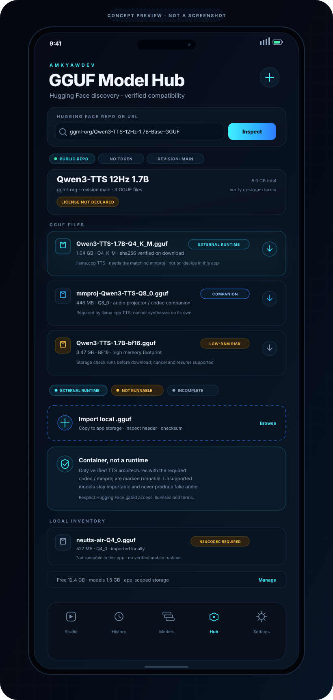

# AmkyawDev TTS Studio

**A dark, mobile-first Flutter text-to-speech studio for Android and iOS.**
Offline Piper ONNX, Gemini native speech generation, an optional VieNeu server
adapter, and a compatibility-first GGUF hub that never fakes a runtime.

[](https://github.com/amkyawdev/amkyawdev-tts-app/actions/workflows/android-building.yml)
[](https://github.com/amkyawdev/amkyawdev-tts-app/releases)


---

## Download

> ### ⚠️ v0.1.0 is a TEST-SIGNED preview
> The APK is signed with the Android **debug** certificate
> (`CN=Android Debug`, SHA-256 `8270e550a2f94cb922fabf504d461c22411694322732f9d3a9166c6eb11ab77c`).
> It is **not** a Play Store or production release.

| | |
| --- | --- |
| **Direct APK** | **[AmkyawDev-TTS-Studio-v0.1.0.apk](https://github.com/amkyawdev/amkyawdev-tts-app/releases/download/v0.1.0/AmkyawDev-TTS-Studio-v0.1.0.apk)** |
| **Release page** | <https://github.com/amkyawdev/amkyawdev-tts-app/releases/tag/v0.1.0> |
| **Size** | 145,678,204 bytes (145.7 MB) |
| **APK SHA-256** | `5823e0c7a159f83d8100816e37b957ed4b8434d0ad95be7ec232057e6988c15f` |
| **Version** | 0.1.0 (versionCode 1) |
| **Package** | `dev.amkyaw.amkyaw_tts_studio` |
| **Android** | 7.0+ (minSdk 24), targetSdk 36 |

### Install on Android

1. Download the APK from the direct link above.
2. Open **Settings → Apps → Special app access → Install unknown apps** (wording
   varies by OEM) and allow your browser or file manager.
3. Open the downloaded APK and tap **Install**.
4. Launch **AmkyawDev TTS Studio**.
5. For Gemini: open **Settings**, paste your own API key and tap **Validate**.
6. For Piper: open **Models**, download the English `en_US-lessac` model, then
   generate from the Studio tab.

The APK requests network access for Gemini, VieNeu and model downloads. It does
not request microphone, contacts or broad storage permissions; exported audio
uses the system share sheet and the document picker.

> **Security note:** because this build is test-signed, Android may show a
> warning. Verify the SHA-256 above before installing. Do not distribute this
> APK as a production build.

---

## Contents

- [Download](#download)
- [Mobile interface previews](#mobile-interface-previews)
- [Current status](#current-status)
- [Features](#features)
- [TTS engines](#tts-engines)
- [Privacy and API keys](#privacy-and-api-keys)
- [Requirements](#requirements)
- [Build from source](#build-from-source)
- [Project structure](#project-structure)
- [Configuration](#configuration)
- [CI/CD, APK builds and signing](#cicd-apk-builds-and-signing)
- [Troubleshooting and FAQ](#troubleshooting-and-faq)
- [Release notes](#release-notes)
- [Contributing](#contributing)
- [Admin / Developer](#admin--developer)
- [License](#license)
- [Acknowledgements](#acknowledgements)

---

## Mobile interface previews

<p align="center">
  
  
</p>

<p align="center"><sub><strong>Left:</strong> Studio concept &nbsp;·&nbsp; <strong>Right:</strong> GGUF Hub concept</sub></p>

> **These are original concept illustrations, not screenshots.** They show the
> intended visual direction. The GGUF Hub screen in the published APK is an
> honest status screen, not a working downloader. Real screenshots will be added
> only when captured from a running build.

---

## Current status

| Area | Status |
| --- | --- |
| Dark mobile UI, Studio, Settings, History, Models, Player | **Implemented** |
| Gemini TTS REST client + secure key storage + validation | **Implemented** |
| Piper model catalogue, checksum download and offline inference code | **Implemented code; device inference unverified** |
| VieNeu OpenAI-compatible server adapter | **Implemented; server required** |
| System TTS fallback | **Implemented** |
| SQLite history, WAV playback, waveform, share/save | **Implemented** |
| Release APK published on GitHub | **Published (TEST-SIGNED)** |
| GGUF Hub repository inspection/download/import | **Planned / not wired in v0.1.0** |
| Burmese offline voice | **Not available** |
| MP3 encoding/export | **Not implemented — disabled** |
| iOS build and release | **Not built in this environment** |
| Production signing | **Not configured** |

`v0.1.0` is a preview. Piper device inference and audio playback have not been
verified on a physical device or emulator in this environment (no `/dev/kvm`,
no connected phone).

---

## Features

### Working in v0.1.0

- **Studio screen** with a long-form script field, character budget, engine
  chips, voice selector, speed control, progress and cancellation.
- **Gemini TTS** via the current Interactions API
  (`POST /v1beta/interactions`, model `gemini-3.8-flash-tts`, WAV output).
  The key is stored in platform secure storage, never in history or logs.
- **Piper ONNX** model manager:
  - English `en_US-lessac-medium-int8` (20.9 MB) and fp32 (67.2 MB).
  - SHA-256 and size verification before extraction.
  - Archive extraction with path-traversal protection.
  - Offline synthesis path using sherpa-onnx + piper-phonemize in a disposable
    isolate.
- **VieNeu adapter** for the official OpenAI-compatible
  `POST /v1/audio/speech` endpoint. No VieNeu inference is bundled.
- **System TTS** fallback using the platform engine.
- **History** in SQLite with text, engine, voice, timestamp, duration, format,
  audio path, delete, clear and replay. API keys are never stored there.
- **Audio player** with real WAV parsing, duration, seek, play/pause, waveform,
  share, save-copy and speed control. MP3 is disabled rather than mislabelled.
- **Settings** for theme, default engine, Piper model,
  speech rate, autoplay, Gemini key, VieNeu URL/token and storage cleanup.
- **Privacy**: no hardcoded keys, no request-body logging, secret redaction in
  diagnostics.

### Experimental or unverified

- Piper inference on a physical Android/iOS device.
- System TTS file containers on iOS (CAF is handled, waveform is unavailable).
- VieNeu over plain HTTP on a LAN. Android's cleartext policy may block it; use
  HTTPS or a local reverse proxy.

### Planned

- GGUF Hub: Hugging Face repo inspection, revision-pinned GGUF listing,
  metadata inspection, resumable download/import, inventory and compatibility
  labels.
- Verified GGUF TTS runtime adapter. Today no on-device Flutter runtime is
  integrated, so no GGUF model is marked runnable.
- Burmese offline Piper voice.
- MP3 encoder.
- Split-per-ABI APKs and iOS CI.
- Production signing and Play Store track.

---

## TTS engines

| Engine | Mode | Status | Notes |
| --- | --- | --- | --- |
| **Piper ONNX** | Offline | Implemented, device-unverified | English `en_US-lessac`; **not Burmese**. Downloads a model on demand. |
| **Gemini TTS** | Online | Implemented | `gemini-3.8-flash-tts`; user key; WAV 24 kHz; quota/network/key errors mapped. Burmese is listed as supported by the model, but quality is not verified here. |
| **VieNeu** | LAN server | Adapter implemented | Official open-source runtime is Python + ONNX Runtime / PyTorch. This app only calls its OpenAI-compatible server. |
| **System TTS** | Device | Implemented | Depends on installed voices; some are online. Android WAV, iOS may be CAF. |

### GGUF: container, not a runtime

GGUF is a model file container. It does **not** guarantee that a file can
synthesize speech. llama.cpp documents TTS support through `libmtmd` for
specific architectures (for example Qwen3-TTS, Pocket TTS, Soprano, LFM3-Audio,
Chatterbox, Drama 3, ZONOS3, Fish Audio S2 Pro, Kokoro), and those models need a
matching `mmproj` audio projector/decoder. OuteTTS, Orpheus, NeuTTS, Spark-TTS
and MOSS-TTS require their own runtimes/codecs and are not runnable through
llama.cpp alone. This app does not claim generic GGUF TTS support, does not route
GGUF through Piper, and never returns fake audio for an unsupported model.

---

## Privacy and API keys

- **Gemini**: the key is entered by the user and stored with
  `flutter_secure_storage`. It is sent only to the configured Gemini endpoint
  (or a build-time backend proxy) as the `x-goog-api-key` header. It is never
  written to SQLite history, logs, screenshots, the README or CI.
- **Piper**: offline. Text and audio stay on the device after the model is
  downloaded. Model downloads use HTTPS to the official sherpa-onnx release
  assets.
- **VieNeu**: text is sent to the server URL you configure. Use HTTPS or a
  trusted local network. The optional bearer token is stored in secure storage.
- **History**: local SQLite only; contains text, engine, voice, timestamp, audio
  path and audio metadata. No credentials.
- **Logs**: debug logging redacts Google-key-shaped strings, `key=` query values
  and bearer tokens. Request bodies are not logged.

There is no analytics SDK, ad SDK or crash-reporting SDK in this build.

---

## Requirements

### To install

- Android 7.0 (API 24) or newer.
- ~150 MB free for the APK, plus 21–67 MB per Piper model, plus generated audio.
- Internet for Gemini, VieNeu or model downloads. Piper generation is offline.

### To build

- Flutter **3.50.1** (Dart 3.14.0)
- JDK 21
- Android SDK Platform 36 and Build Tools 36.0.0
- macOS + Xcode for iOS builds (not available in this environment)

---

## Build from source

```bash
git clone https://github.com/amkyawdev/amkyawdev-tts-app.git
cd amkyawdev-tts-app
flutter pub get

# Formatting and static checks
dart format --output=none --set-exit-if-changed lib test integration_test
flutter analyze

# Tests
flutter test

# Android artifacts
flutter build apk --release
flutter build appbundle --release
```

Outputs:

- `build/app/outputs/flutter-apk/app-release.apk`
- `build/app/outputs/bundle/release/app-release.aab`

If `flutter analyze` reports formatting differences, run `dart format lib test
integration_test` and re-run the checks.

### Why the APK is large

The universal APK is **145.7 MB** because it packages native code for multiple
ABIs (arm64-v8a, armeabi-v7a, x86_64), including sherpa-onnx/ONNX Runtime,
piper-phonemize/espeak-ng and the Flutter engine. **No TTS model is bundled.**
Split-per-ABI builds would cut the per-device download substantially; they are
planned and not yet published.

---

## Project structure

```text
lib/
  app.dart                     App shell, navigation, shared UI
  main.dart                    Dependency bootstrap + Riverpod scope
  app_dependencies.dart        Injected services
  core/                        Theme, errors, logging, formatters
  services/                    Settings, SQLite history, secure keys, storage,
                               export, key-value store
  providers/                   Riverpod controllers for studio, history,
                               models, player
  tts/
    models/                    Engine, voice, request/result, progress types
    chunking/                  Sentence-aware text chunker
    audio/                     RIFF/WAVE parser, encoder, merger, waveform
    engines/
      piper/                   Manifest, download manager, isolate inference
      gemini/                  Interactions API client + 30 prebuilt voices
      vieneu/                  OpenAI-compatible server adapter
      system/                  Platform TTS wrapper
    engine_registry.dart
  features/
    studio/                    Script, engine/voice, generate, progress
    history/                   Local history list and replay
    models/                    Piper model manager
    hub/                       GGUF compatibility status screen
    player/                    Waveform player and WAV export sheet
    settings/                  Keys, defaults, storage, privacy
    about/                     Version, limitations, licenses
assets/readme/                 Concept preview SVGs
test/                          Unit + widget tests
integration_test/              On-device smoke test
.github/workflows/             Android build and release workflow
```

---

## Configuration

### Gemini

The key is entered at runtime in **Settings → Gemini API key**. It is never
compiled into the app.

Optional build-time configuration:

```bash
flutter build apk --release \
  --dart-define=GEMINI_API_BASE_URL=https://generativelanguage.googleapis.com \
  --dart-define=GEMINI_TTS_MODEL=gemini-3.8-flash-tts
```

`GEMINI_API_BASE_URL` can point to a backend proxy that implements the same
Interactions API schema. A proxy is recommended for shared keys; do not embed a
shared key in the APK.

### VieNeu

Set the server URL and optional bearer token in **Settings → VieNeu server**. The
server must expose `POST /v1/audio/speech` with `response_format=wav`. The
official server runs on Python; this app does not bundle it. Plain HTTP may be
blocked by Android's cleartext policy—use HTTPS or a local reverse proxy.

### Piper

Choose a model in **Settings → Piper model**, download it in **Models**, then
generate. Models are stored in app-scoped storage and can be deleted at any
time. The catalogue is English only.

---

## CI/CD, APK builds and signing

Workflow: [`.github/workflows/android-building.yml`](.github/workflows/android-building.yml)

<https://github.com/amkyawdev/amkyawdev-tts-app/actions/workflows/android-building.yml>

Triggers:

- Push to `main`
- Pull request targeting `main`
- Push of a `v*` tag
- Manual `workflow_dispatch`

Jobs:

1. **Format, analyze and test** — `dart format --set-exit-if-changed`,
   `flutter analyze`, `flutter test`.
2. **Build APK and AAB** — Java 21, Flutter 3.50.1, Gradle cache, release APK
   and AAB, uploaded as an Actions artifact.
3. **Publish GitHub Release** — runs only for `v*` tags, downloads the artifact
   and attaches `app-release.apk` and `app-release.aab`.

### Signing

No keystore or password is committed. Production signing is enabled **only
when all four secrets are present**:

| Secret | Purpose |
| --- | --- |
| `ANDROID_KEYSTORE_BASE64` | Base64 JKS/PKCS12 keystore |
| `ANDROID_KEYSTORE_PASSWORD` | Keystore password |
| `ANDROID_KEY_ALIAS` | Release key alias |
| `ANDROID_KEY_PASSWORD` | Key password |

If any secret is missing, the workflow does not decode a keystore and Gradle
falls back to the debug signing config. The artifact is named
`...-test-signed` and the job summary says debug/test key. A keystore is decoded
only into `$RUNNER_TEMP` and is never committed.

The published `v0.1.0` APK was built locally with the debug key and is labelled
**TEST-SIGNED / NOT FOR PRODUCTION**.

---

## Troubleshooting and FAQ

**`flutter analyze` fails on formatting in CI.**
Run `dart format lib test integration_test` and commit the result.

**The APK will not install.**
Allow "Install unknown apps" for the app opening the APK. If Android reports a
signature conflict with another install, uninstall the previous copy first.

**Gemini returns 401/403.**
The key is invalid, restricted or lacks access. Use **Validate** in Settings and
check the key's API restrictions. A 429 means quota or rate limit; wait or use a
different key.

**Piper says "Download model".**
Open **Models**, download an English model and wait for checksum verification.
Model files are not bundled. The lessac model does not speak Burmese.

**Piper generation is slow.**
Inference runs in a disposable isolate; the first request pays model-load cost.
A warm-worker design is future work.

**VieNeu connection fails.**
Confirm the server exposes `/v1/audio/speech` and returns WAV. Android may block
plain HTTP; use HTTPS or a local reverse proxy.

**Can it synthesize Burmese offline?**
Not in v0.1.0. The only Piper catalogue is English. Gemini 3.8 Flash TTS lists
Burmese support, but that is online and its quality is not verified by this app.

**Can I run any GGUF file?**
No. GGUF is a container. The Hub is not wired in v0.1.0, and no on-device GGUF
TTS runtime is verified in this app.

**Where are my files?**
Audio and models are in app-scoped storage. Use **Share** or **Save copy** in the
player to export WAV. Uninstalling the app removes app-scoped files.

---

## Release notes

### v0.1.0 — TEST-SIGNED preview (2026-11-26)

- First published preview APK.
- Dark mobile Studio UI, engine/voice selection, progress and cancellation.
- Gemini TTS client with secure key storage and validation.
- Piper model manager and offline inference code.
- VieNeu server adapter; System TTS fallback.
- SQLite history, WAV player/waveform, share and save-copy.
- Honest GGUF compatibility screen; no generic GGUF TTS claim.

**Limitations:** test/debug-signed; Piper device inference unverified; English
Piper only; VieNeu requires a server; GGUF Hub not wired; MP3 disabled; iOS not
built.

Release: <https://github.com/amkyawdev/amkyawdev-tts-app/releases/tag/v0.1.0>

---

## Contributing

Issues and pull requests are welcome. Please:

- Keep all engines behind the `TtsEngine` interface.
- Never add fake audio, placeholder model files or hardcoded API keys.
- Mark unsupported runtimes as unsupported with a reason.
- Run `dart format`, `flutter analyze` and `flutter test` before opening a PR.
- Do not commit keystores, `.env` files or secrets.

---

## Admin / Developer

[](https://www.tiktok.com/@amkyaw.dev1)

- **TikTok:** [@amkyaw.dev1](https://www.tiktok.com/@amkyaw.dev1)

---

## License

No `LICENSE` file is present in this repository, so the application source is
**not** granted an open-source license by default. Do not redistribute the app
code or APK as your own production product without permission.

Third-party components retain their own licenses:

- **sherpa-onnx** — Apache-2.0.
- **piper-phonemize / espeak-ng** — GPL-3.0. Review GPL obligations before
  redistributing a binary that includes them.
- **Piper voice models** — follow each model card and dataset license (the
  lessac model card references the Lessac Blizzard 2013 dataset license).
- Flutter, Riverpod, just_audio, sqflite, flutter_secure_storage, share_plus,
  file_picker, archive, http, crypto and other packages — their upstream
  licenses.

Gemini and VieNeu are external services governed by their own terms.

---

## Acknowledgements

- [sherpa-onnx](https://github.com/k2-fsa/sherpa-onnx) for offline VITS/Piper
  inference.
- [piper-phonemize](https://pub.dev/packages/piper_phonemize) and
  [espeak-ng](https://github.com/espeak-ng/espeak-ng) for phonemization.
- [Piper](https://github.com/OHF-Voice/piper1-gpl) and the
  [rhasspy/piper-voices](https://huggingface.co/rhasspy/piper-voices) catalogue.
- [Google Gemini API](https://ai.google.dev/gemini-api/docs/speech-generation)
  for the speech-generation documentation.
- [VieNeu-TTS](https://github.com/pnnbao97/VieNeu-TTS) for the optional server
  integration target.
- [llama.cpp](https://github.com/ggml-org/llama.cpp) for the verified external
  TTS runtime documentation.
- The Flutter, Riverpod, just_audio and sqflite communities.
