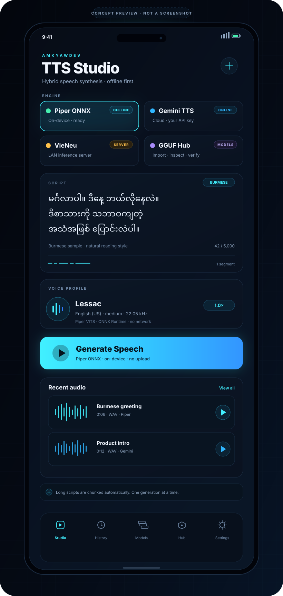

# AmkyawDev TTS Studio

**Repository:** `amkyawdev-tts-app`

AmkyawDev TTS Studio - hybrid offline/online text to speech

## Getting Started

This project is a starting point for a Flutter application.

A few resources to get you started if this is your first Flutter project:

- [Learn Flutter](https://docs.flutter.dev/get-started/learn-flutter)
- [Write your first Flutter app](https://docs.flutter.dev/get-started/codelab)
- [Flutter learning resources](https://docs.flutter.dev/reference/learning-resources)

For help getting started with Flutter development, view the
[online documentation](https://docs.flutter.dev/), which offers tutorials,
samples, guidance on mobile development, and a full API reference.

---

## Mobile Interface Preview

  
  

<strong>Left:</strong> TTS Studio home concept &nbsp;·&nbsp; <strong>Right:</strong> Hugging Face GGUF Model Hub concept

> **These are original concept previews, not screenshots of a completed app.**
> They show design intent only. Labels, colors, engine states and features may
> change, and nothing in these images should be read as a claim that a feature
> is implemented or that a particular model can synthesize speech on-device.
> GGUF is a model container, not a universal TTS runtime; only verified
> architectures with the required codec / projector are marked runnable.
> Refer to the repository documentation for the current implementation status.

